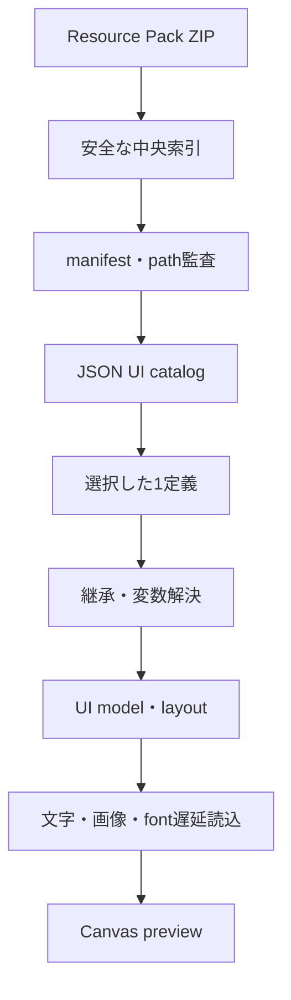

# JSON UI Preview Studio — 実装・忠実度アーキテクチャ

更新日: 2026-09-01 UTC  
対象: Minecraft Bedrock Resource Pack の JSON UI をブラウザ内で安全に解析・プレビューする静的Webアプリ

## 1. 結論

本アプリは、Resource Pack ZIPを一括展開せずに索引化し、JSON UIの各トップレベル定義を個別に選択し、同一namespace・別namespace・別ファイル・Vanilla基底を含む継承を解決してからプレビューする。文字列は選択localeの`.lang`、画像は実パック内のTGA/PNG/JPG/JPEG、フォントは利用可能なパック内fontを遅延読込する。

これはBedrock本体のrendererを再実装したものではない。公式公開仕様で確定できないmerge順序、runtime binding、factory、custom renderer、入力・focus、animation、pixel roundingは明示的な近似または未対応として診断する。したがって「形が似る」ことと「実機同一」を混同しない。

## 2. 根拠の階層

| 階層 | 意味 | 本アプリでの扱い |
|---|---|---|
| `official-confirmed` | Microsoft LearnまたはMojang一次配布で確認 | property surface、namespace、`@`、`$`、`_ui_defs`等 |
| `vanilla-observed` | 固定したVanilla資料内で観測 | 使用property、namespace参照、画面構成、asset path |
| `device-verified` | 対象build・条件を固定した実機証拠 | v26.45の一部layer／nine-slice等に限定 |
| `approximation` | 公開仕様に完全規定がなく、プレビュー用に採用 | deep object merge、array replace、限定的`controls` modifications、同順位winner等 |
| `unverified` | 未採証または入力不足 | Pocket描画、factory lifecycle、全画面pixel一致等 |

公式参照:

- [UI screen](https://learn.microsoft.com/en-us/minecraft/creator/reference/content/jsonuireference/examples/jsonuicomponents/ui_screen?view=minecraft-bedrock-stable)
- [UI definitions](https://learn.microsoft.com/en-us/minecraft/creator/reference/content/jsonuireference/examples/jsonuicomponents/ui_defs?view=minecraft-bedrock-stable)
- [Mojang bedrock-samples release](https://github.com/Mojang/bedrock-samples/releases/tag/v1.26.40.05)
- [zip.js BlobReader](https://gildas-lormeau.github.io/zip.js/api/classes/BlobReader.html)

## 3. 処理パイプライン

各段階は前段の全データを複製しない。ZIPは`File`/`BlobReader`を保持し、中央ディレクトリとpath索引を先に構築する。JSON、raster texture、font、`.lang`は必要になった時点で個別に読む。

## 4. 大容量ZIP

- 圧縮ZIP上限: 600 MiB
- entry上限: 120,000
- 全entryの宣言展開量上限: 2 GiB
- 単entry読込上限: 64 MiB
- text単体上限: 8 MiB
- entry圧縮率の警戒閾値: 200倍
- 暗号化ZIP: 拒否
- 正規化後の重複path、drive path、scheme、root逸脱: 拒否
- ZIP CRCとoverlap: pinned zip.js 2.8.16の実APIで検査
- decompression: self-hosted Web Worker/WASMを優先
- path asset index: 一定時間ごとにmain threadへyield
- catalog: JSON/JSONCのみ最大64 MiBまで段階読込
- cancellation: ZIP索引、asset索引、UI catalog、entry readへ`AbortSignal`を伝播

停止操作では現在generationを失効させ、遅れて完了した旧処理が新runtimeへcommitしない。失敗時はReaderをcloseし、同期asset indexへのfallbackは中断時には実行しない。

## 5. UI catalog

各JSON/JSONCファイルについて、`namespace`以外のトップレベルobjectを一つの選択可能定義として登録する。これにより、1ファイルに複数UIがある場合でも、ユーザーはファイル選択の次に定義を選択できる。

catalogは次を記録する。

- source: imported / vanilla
- file path、namespace、raw key、local name、base reference
- classification: `SCREEN` / `COMPONENT` / `UNREFERENCED_ROOT` / `ANIMATION_OR_DATA` / `POCKET_ONLY`
- 静的reference集合
- source precedenceとshadow candidate
- parse・limit・namespace診断

同名symbolはimported packをVanillaより優先する。同一precedence内の完全なBedrock読込順は公開仕様で保証されないため、pathとIDによる決定的順序を採用し、`UI_SYMBOL_SHADOWED`を出す。

## 6. ファイル横断継承

`name@namespace.base`と、同一namespace内の`name@base`をcatalog全体から検索する。選択定義だけをrootに残し、参照した全定義をprovenanceとして記録する。

動的template `content@$template` は、最終派生UIのlocal variable、`|default`、global variable、呼出し側変数を合成してから解決する。これにより、基底のdefaultを派生側が上書きする通常のtemplate patternを扱える。変数が未定義、非文字列、または参照先がない場合は、黙って空要素へ置換せず次を出す。

- `UI_DYNAMIC_BASE_UNRESOLVED`
- `UI_DYNAMIC_BASE_TARGET_NOT_FOUND`
- `UI_BASE_NOT_FOUND`
- `UI_CONTROL_BASE_NOT_FOUND`
- `UI_INHERITANCE_CYCLE`

再帰深度、control深度、展開object数に上限を設け、循環または指数的展開で停止し続けない。

## 7. merge profile

現在のprofileは`deep-object-array-replace-array-modifications-v3`である。

- object + object: 再帰merge
- scalar: 派生値で置換
- array: 派生array全体で置換
- local/global variable: 完全一致する`$name`値を再帰置換
- 同名symbolに`modifications`だけがある場合: 下位packの同名symbolを暗黙baseとして、`controls` / `bindings` / `button_mappings`の`insert_front` / `insert_back` / `insert_before` / `insert_after` / `move_front` / `move_back` / `remove` / `replace`を上限付きで適用。bindings等の`where`は空でないscalar属性の完全一致のみ。配列全体を走査する累積回数も制限する

これは公開資料だけでは完全確定できない部分を含む。未対応operation、対象なし、操作数・配列長上限超過は推測適用せずwarningにする。画面にはprofile名を表示し、`UI_MERGE_PROFILE_APPROXIMATE`を残す。将来別profileを実装しても、既存結果を無言で変更しない。

## 8. Pocket policy

pathまたはnamespaceがPocket profileと判定されたJSONは、次を許可する。

- ZIP読込
- path索引
- JSON parse
- catalog登録
- raw確認

次は禁止する。

- effective DisplayList生成
- preview開始
- Classicと同等という表示

UI上では定義を「Pocket・表示不可」と明示し、resolver境界でも`POCKET_PREVIEW_BLOCKED`でfail closedする。Classic定義からPocket専用定義へ依存した場合も安全側で停止する。

## 9. 文字列

- labelは`localize: false`だけをliteralとして扱い、それ以外はlocalize対象とする。
- imported packの選択localeを先に検索し、必要に応じてVanilla referenceへfallbackする。
- `.lang`のkey欠落は文字列keyを残し、捏造した翻訳へ置換しない。
- export dependency scanも同じdefault-localize規則を使う。
- color配列、alpha、shadow、alignment、vertical alignment、font scaleをCanvas metadataへ反映する。
- pack内fontは対応形式を遅延読込し、`FontFace`登録後に再描画する。

## 10. texture

- imported packを優先し、次にVanilla referenceを検索する。
- pathは大文字小文字を区別して保持し、検索indexのみcase-insensitiveにする。
- Bedrockの優先順位（TGA、PNG、JPG、JPEG）でrasterを解決し、遅延読込する。画面外imageは読込を遅らせる。
- `uv` / `uv_size`でsource cropを行う。
- `keep_ratio`、`bilinear`、alphaを反映する。
- `nineslice_size`、同名textureのJSON sidecar、per-edge fieldをCanvas nine-sliceへ変換する。
- 見つからないtextureはmissingとして診断し、別画像を推測しない。

実機R11の限定観測では、Retail v26.45の対象・値4・作成済みimage controlに対して`nineslice_size: 4`が受理された。一方、同環境では`nine_slice_left/right/top/buttom`がunknown propertyになった。後者は現行公開property surfaceとの不一致を含むため、本アプリは両表記を読めるが、どちらも全buildでの実機互換を保証しない。

## 11. layout・layer

anchor、offset、数値、単純な`%`および加減算だけの線形式のsize、`min_size` / `max_size`、stack、grid、layerを決定的layoutへ変換し、draw順とhit testでlayerを考慮する。明示`grid_dimensions`のtrack間隔はgrid全体を列・行数で分割して求める一方、子の通常`%`寸法は親であるgrid全体を基準に一度だけ評価する。これにより、公式5×5 gridの`40%`幅（2列span）や1×3 enchanting gridの`33.333333%`高をcell内で再縮小しない。size未指定と`fill`軸だけはtrack割当を基準にする。`default`は型別に扱い、structural panel / input panelでは親の既定領域、stack / gridでは配列方向・trackの自然寸法、button / toggleでは安全に選んだ状態controlの自然寸法を使う。size未指定gridは固定templateとdimensionsから自然trackを作り、親全域へ引き延ばさない。実機観測では高いlayerのlabelが低いlayerの兄弟imageより前に見えた範囲を採用している。

`%c`は安全状態で有効な子寸法の合計、`%cm`は最大子寸法として軸別に解決し、`%sm`を含む相互依存は作業量上限付き固定点計算と決定的fallbackで処理する。任意の乗除算・関数を含む寸法式は限定対応である。同layer、親子を跨ぐ比較、input順、clipとlayerの完全な優先規則も未確定である。Canvasの補助線・selection handleは編集表示であり、忠実度表示では隠す。

## 12. 対応外または限定対応

- binding providerの実ゲーム状態
- factory / collection lifecycle
- 未認識custom renderer（banner・enchanting book・horseは既存box内の中立的surrogateのみ）
- animationの実時間補間
- focus graph、controller/touch/keyboardの完全挙動
- 任意の乗除算・関数を含む寸法式、複合したmin/max制約
- 祖先clip、scroll viewport、text wrap
- Minecraft標準bitmap glyphと完全なfont metric
- atlas固有処理とMinecraft内部renderer固有のtexture処理
- 全font metricとpixel rounding
- shader、atlas内部、Minecraft独自描画
- 実機Pocket UI
- target buildと一致しないVanilla ZIPの「正解」扱い

mock bindingは設計確認用であり、ゲーム状態の証明ではない。

## 13. Vanilla reference gate

Vanilla ZIPは、target version、source release、target/source channel、必須path、重要JSONのparse数を監査する。structureが使えても、公式sourceとhash receiptをブラウザ内だけで証明できない場合はwarningに留める。

本成果物の最終監査では、Mojang `bedrock-samples` の `v1.26.40.05` resource packを基底にし、添付packを上位層として同時に解決した。ただし、公開sampleの処理成功をMinecraft本体のruntime描画・入力・bindingの実機合格とは扱わない。

## 14. 検証

- pure module unit test: 338件
- site integration test: 18件
- Mojang `v1.26.40.05` + 添付packカタログ: 239候補、238 UI文書、6,756定義、6,611 symbol
- 添付packのClassic target: 17ファイル、24 screenを全件解決
- 24/24 screenで有限座標・境界上限内、truncation 0、layout measurement budget超過 0、allocated-context上限超過 0
- Pocket定義: 537件、preview拒否
- release parity、static asset、CRC負試験、ZIP integrityを最終gateで再実行

PASSは上記範囲に限定する。ブラウザを実行していない環境、未取得input、Minecraft実機で未実行の画面をPASSへ昇格しない。
